<!-- OSS:START -->

<picture><source media="(prefers-color-scheme: dark)" srcset="assets/header-dark.svg"></picture>

### About me

I like building things that solve real problems. Watching an idea turn into something that actually runs is what gives me the kick, and it's what keeps me going when a bug has been winning for hours.

Finance and low-latency systems are what I find most interesting. I'm drawn to the problems high-frequency trading firms work on: how fast a system is, how predictable it is, and whether every state change can be replayed and checked. My order book and matching engine is where I've started digging in.

I also fix bugs upstream in open-source AI and data tooling, from agent frameworks to data pipelines, because reading other people's production code is the fastest way I know to get better at writing my own.

Three of my projects have published patent applications: Smart Flow Analysis and Trade Execution, Readease, and Dropr.

### Open source

<a href="https://github.com/freeCodeCamp/freeCodeCamp/pulls?q=is%3Apr%20author%3AAryanSingh2029%20is%3Amerged"><picture><source media="(prefers-color-scheme: dark)" srcset="assets/merged-freecodecamp-freecodecamp-dark.svg">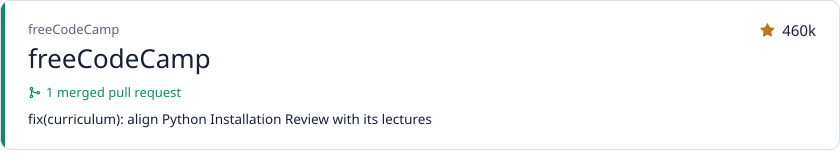</picture></a>

<a href="https://github.com/repowise-dev/repowise/pulls?q=is%3Apr%20author%3AAryanSingh2029%20is%3Amerged"><picture><source media="(prefers-color-scheme: dark)" srcset="assets/merged-repowise-dev-repowise-dark.svg">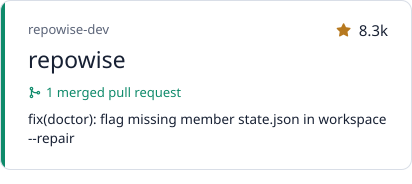</picture></a>
<a href="https://github.com/neomjs/neo/pulls?q=is%3Apr%20author%3AAryanSingh2029%20is%3Amerged"><picture><source media="(prefers-color-scheme: dark)" srcset="assets/merged-neomjs-neo-dark.svg">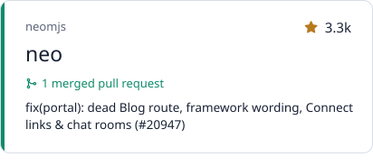</picture></a>
<a href="https://github.com/CrossGL/crosstl/pulls?q=is%3Apr%20author%3AAryanSingh2029%20is%3Amerged"><picture><source media="(prefers-color-scheme: dark)" srcset="assets/merged-crossgl-crosstl-dark.svg">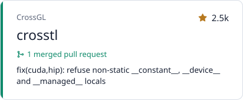</picture></a>
<a href="https://github.com/vshulcz/deja-vu/pulls?q=is%3Apr%20author%3AAryanSingh2029%20is%3Amerged"><picture><source media="(prefers-color-scheme: dark)" srcset="assets/merged-vshulcz-deja-vu-dark.svg">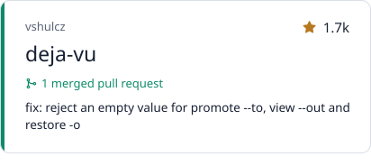</picture></a>
<a href="https://github.com/kividbio/kividb/pulls?q=is%3Apr%20author%3AAryanSingh2029%20is%3Amerged"><picture><source media="(prefers-color-scheme: dark)" srcset="assets/merged-kividbio-kividb-dark.svg">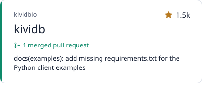</picture></a>
<a href="https://github.com/plantain-00/type-coverage/pulls?q=is%3Apr%20author%3AAryanSingh2029%20is%3Amerged"><picture><source media="(prefers-color-scheme: dark)" srcset="assets/merged-plantain-00-type-coverage-dark.svg">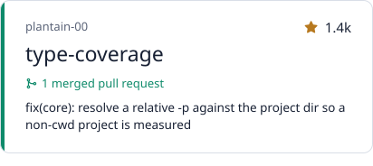</picture></a>

#### In review

- [apache/seatunnel#13455](https://github.com/apache/seatunnel/pull/13455): [Bug] [docs] Consolidate duplicate sections in Calcite, JDBC, Mem0, and Kafka Connect…
- [maziyarpanahi/openmed#5518](https://github.com/maziyarpanahi/openmed/pull/5518): fix(privacy-proxy): keep tool/response-format config unredacted and fail closed on…
- [dateutil/dateutil#1672](https://github.com/dateutil/dateutil/pull/1672): Fix parser dropping the year in 'may15,2021' (comma before a 4-digit year) (#1191)
- [CrossGL/crosstl#4465](https://github.com/CrossGL/crosstl/pull/4465): fix(wgsl): model a bare gl_Position vertex write as a @builtin(position) output (#4388)
- [pykale/pykale#623](https://github.com/pykale/pykale/pull/623): fix: keep the gradient to a zero-weight expert in Gaussian fusions (#622)
- [BSC-ES/autosubmit#3422](https://github.com/BSC-ES/autosubmit/pull/3422): fix: don't crash when a command is run from a deleted working directory (#3332)

### Things I've built

<a href="https://github.com/AryanSingh2029/OrderBook"><picture><source media="(prefers-color-scheme: dark)" srcset="assets/project-orderbook-dark.svg"></picture></a>

<a href="https://github.com/AryanSingh2029/Smart-Flow-Analysis-and-Trade-Execution"><picture><source media="(prefers-color-scheme: dark)" srcset="assets/project-smart-flow-analysis-and-trade-execution-dark.svg">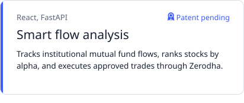</picture></a>
<a href="https://github.com/AryanSingh2029/Readease"><picture><source media="(prefers-color-scheme: dark)" srcset="assets/project-readease-dark.svg"></picture></a>
<a href="https://github.com/AryanSingh2029/Dropr"><picture><source media="(prefers-color-scheme: dark)" srcset="assets/project-dropr-dark.svg">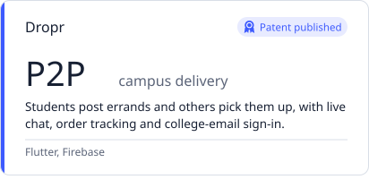</picture></a>
<a href="https://github.com/AryanSingh2029/Housesense"><picture><source media="(prefers-color-scheme: dark)" srcset="assets/project-housesense-dark.svg"></picture></a>
<a href="https://github.com/AryanSingh2029/Google-Pay-Finance-Tracker"><picture><source media="(prefers-color-scheme: dark)" srcset="assets/project-google-pay-finance-tracker-dark.svg"></picture></a>
<a href="https://github.com/AryanSingh2029/oneofus"><picture><source media="(prefers-color-scheme: dark)" srcset="assets/project-oneofus-dark.svg">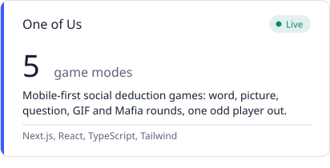</picture></a>

### Patent applications

<picture><source media="(prefers-color-scheme: dark)" srcset="assets/patents-dark.svg">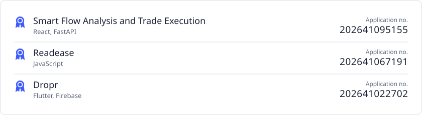</picture>

Rebuilt from the GitHub API every six hours. Last update 2026-11-26.

<!-- OSS:END -->
