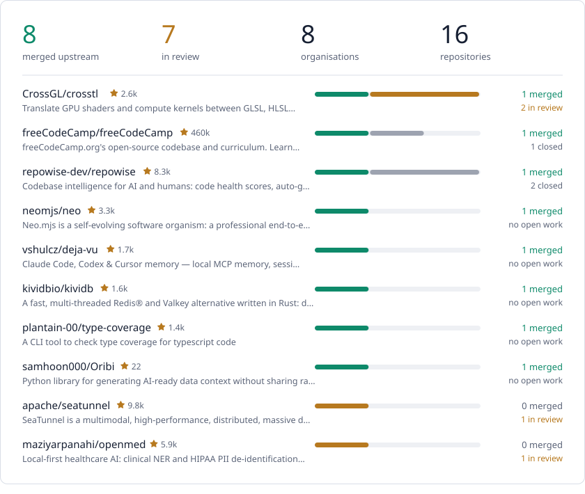
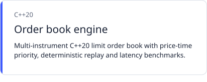
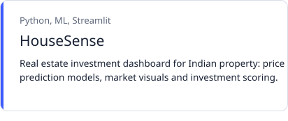

<!-- OSS:START -->

<picture><source media="(prefers-color-scheme: dark)" srcset="assets/header-dark.svg"></picture>

### About me

I like building things that solve real problems. Watching an idea turn into something that actually runs is what gives me the kick, and it's what keeps me going when a bug has been winning for hours.

Finance and low-latency systems are what I find most interesting. I'm drawn to the problems high-frequency trading firms work on: how fast a system is, how predictable it is, and whether every state change can be replayed and checked. My order book and matching engine is where I've started digging in.

I also fix bugs upstream in open-source AI and data tooling, from agent frameworks to data pipelines, because reading other people's production code is the fastest way I know to get better at writing my own.

Three of my projects have published patent applications: Smart Flow Analysis and Trade Execution, Readease, and Dropr.

### Open source

<a href="https://github.com/pulls?q=is%3Apr%20author%3AAryanSingh2029"><picture><source media="(prefers-color-scheme: dark)" srcset="assets/opensource-dark.svg"></picture></a>

<table><tr><th align="left" width="50%">Recently merged</th><th align="left" width="50%">In review now</th></tr>
<tr><td valign="top"><ul><li><a href="https://github.com/samhoon000/Oribi/pull/165"><code>samhoon000/Oribi#165</code></a> fix: detach mutable values nested inside tuple samples (#160) merged 2026-11-23</li><li><a href="https://github.com/neomjs/neo/pull/20951"><code>neomjs/neo#20951</code></a> fix(portal): dead Blog route, framework wording, Connect links &amp; chat rooms… merged 2026-11-16</li><li><a href="https://github.com/repowise-dev/repowise/pull/5245"><code>repowise-dev/repowise#5245</code></a> fix(doctor): flag missing member state.json in workspace --repair merged 2026-11-08</li><li><a href="https://github.com/plantain-00/type-coverage/pull/159"><code>plantain-00/type-coverage#159</code></a> fix(core): resolve a relative -p against the project dir so a non-cwd project… merged 2026-11-04</li><li><a href="https://github.com/vshulcz/deja-vu/pull/5906"><code>vshulcz/deja-vu#5906</code></a> fix: reject an empty value for promote --to, view --out and restore -o merged 2026-11-03</li><li>and 3 more merged</li></ul></td><td valign="top"><ul><li><a href="https://github.com/apache/seatunnel/pull/13455"><code>apache/seatunnel#13455</code></a> [Bug] [docs] Consolidate duplicate sections in Calcite, JDBC, Mem0, and Kafka… opened 2026-11-25</li><li><a href="https://github.com/CrossGL/crosstl/pull/4465"><code>CrossGL/crosstl#4465</code></a> fix(wgsl): model a bare gl_Position vertex write as a @builtin(position) output… opened 2026-11-13</li><li><a href="https://github.com/pykale/pykale/pull/623"><code>pykale/pykale#623</code></a> fix: keep the gradient to a zero-weight expert in Gaussian fusions (#622) opened 2026-11-12</li><li><a href="https://github.com/BSC-ES/autosubmit/pull/3422"><code>BSC-ES/autosubmit#3422</code></a> fix: don&#x27;t crash when a command is run from a deleted working directory (#3332) opened 2026-11-11</li><li><a href="https://github.com/dateutil/dateutil/pull/1672"><code>dateutil/dateutil#1672</code></a> Fix parser dropping the year in &#x27;may15,2021&#x27; (comma before a 4-digit year)… opened 2026-11-10</li><li>and 1 more open</li></ul></td></tr></table>

### Things I've built

<a href="https://github.com/AryanSingh2029/OrderBook"><picture><source media="(prefers-color-scheme: dark)" srcset="assets/project-orderbook-dark.svg"></picture></a>

<a href="https://github.com/AryanSingh2029/Smart-Flow-Analysis-and-Trade-Execution"><picture><source media="(prefers-color-scheme: dark)" srcset="assets/project-smart-flow-analysis-and-trade-execution-dark.svg"></picture></a>
<a href="https://github.com/AryanSingh2029/Readease"><picture><source media="(prefers-color-scheme: dark)" srcset="assets/project-readease-dark.svg"></picture></a>
<a href="https://github.com/AryanSingh2029/Dropr"><picture><source media="(prefers-color-scheme: dark)" srcset="assets/project-dropr-dark.svg"></picture></a>
<a href="https://github.com/AryanSingh2029/Housesense"><picture><source media="(prefers-color-scheme: dark)" srcset="assets/project-housesense-dark.svg"></picture></a>
<a href="https://github.com/AryanSingh2029/Google-Pay-Finance-Tracker"><picture><source media="(prefers-color-scheme: dark)" srcset="assets/project-google-pay-finance-tracker-dark.svg"></picture></a>
<a href="https://github.com/AryanSingh2029/oneofus"><picture><source media="(prefers-color-scheme: dark)" srcset="assets/project-oneofus-dark.svg"></picture></a>

### Published patents

<picture><source media="(prefers-color-scheme: dark)" srcset="assets/patents-dark.svg"></picture>

Rebuilt from the GitHub API every six hours. Last update 2026-11-27.

<!-- OSS:END -->
